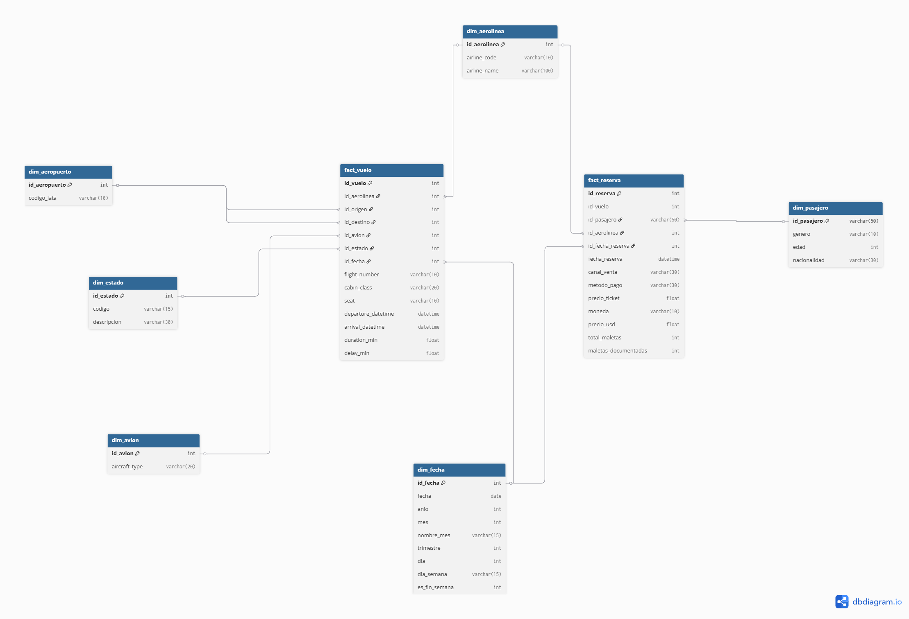

# Práctica No. 1: ETL con Python
Seminario de Sistemas 2

**Nombre:** Christian Josué Hernández Juárez

**Carnet:** 201902125

## Descripción del Proyecto

La realización de esta practica tuvo como objetivo la implementación de un proceso ETL (Extract, Transform, Load) en Python que integró dos Datasets de registro de vuelos y pasajeros, los transformó y cargó en un modelo multidimensional en SQL Server, listo para el análisis de inteligencia de negocios. 

El escenario simula el manejo de información de una aerolínea donde los datos provienen de múltiples fuentes y los cuales tienen que ser estandarizados para su respectivo análisis.

## Proceso ETL

### Fase 1: Extracción

En esta fase se leen los archivos CSV utilizando pandas, detectando automáticamente la codificación UTF-8 BOM y los separadaroes distintos (, y ;).

```python
df_vuelos    = pd.read_csv("csvs/Dataset_1.csv", encoding="utf-8-sig")
df_pasajeros = pd.read_csv("csvs/Dataset_2.csv", sep=";", encoding="utf-8-sig")
```

### Fase 2: Transformación

Acá se identificaron y corrigieron los problemas en los datos crudos (limpieza).

- Para estandarizar códigos en mayúsculas como el de los aeropuertos se utilizó str.upper()

- Fechas con múltiples formatos, se requirió parsearlas a un único formato utilizando pd.to_datatime

- Género con múltiples variantes, se requirió estandarizar esto asignandole a cada variante un letra según corresponde (M, F o X)

- En ticke_price hubo un problema teniendo comas en los decimales en lugar de los puntos, por lo que se utilizó str.replace(",", ".") entes del casteo numérico.

- Nulos en los datos de algunas columnas, se le reemplazó el valor NULL con diferentes datos, por ejemplo: nacinality y sales_channel se les puso 'DESCONOCIDO'


En esta fase se generaron distintos CSV:

1. DIM_AEROLINEA
2. DIM_AEROPUERTO
3. DIM_AVION
4. DIM_FECHA
5. DIM_ESTADO
6. DIM_PASAJERO
7. FACT_VUELO
8. FACT_RESERVA

### Fase 3: Carga

En esta fase se realizaron los siguientes pasos: 
- Se hizo la conexión a la base de datos mediante SQLAlchemy con Windows Authentication.

- Se realizó la inserción por lotes (chuncksize=500) usando DataFrame.to_sql.

- Las dimensiones se cargaron antes que los hechos para respetar las claves foráneas.

- En caso de que el SQL server no esté disponible, los datos transformados se exportan como CSV en la carpeta /csvs_limpios/.

## Modelo Multidimensional

### Tipo de modelo Implementado: Constelación



El modelo que decidí implementar fue el de constelación, debido a que el sistema manejó dos procesos de negocio distintos: el de vuelo y el de reservación del pasajero. Cada uno de estos procesos tienen sus propias métricas, lo cuál ayudó a identificar esas dos tablas de hechos. 

No se utilizó el modelo de estrella debido a que solo admite una tabla de hechos, lo que hubiera ocacionado mezclar métricas operacionales (como lo son duración y atraso) con métricas económicas (como precio de ticket y maletas) en una tabla, lo cual afectaría la claridad del modelo.

Tampoco decidí utilizar un copo de nieve porque en las tablas que creé no fue necesario normalizarlas en más subtablas.

## Consulta Analíticas

### 1. Total de vuelos por estado

```sql
SELECT
    de.descripcion        AS estado,
    COUNT(*)              AS total_vuelos
FROM fact_vuelo fv
JOIN dim_estado de ON fv.id_estado = de.id_estado
GROUP BY de.descripcion
ORDER BY total_vuelos DESC;
```

### 2. Top 5 aerolíneas con más vuelos

```sql
SELECT TOP 5
    da.airline_name       AS aerolinea,
    COUNT(*)              AS total_vuelos
FROM fact_vuelo fv
JOIN dim_aerolinea da ON fv.id_aerolinea = da.id_aerolinea
GROUP BY da.airline_name
ORDER BY total_vuelos DESC;
```

### 3. Distribución de pasajeros por género

```sql
SELECT
    genero,
    COUNT(*)              AS total_pasajeros
FROM dim_pasajero
GROUP BY genero
ORDER BY total_pasajeros DESC;
```

### 4. Top 5 Destinos más populares

```sql
SELECT TOP 5
    da.codigo_iata        AS destino,
    COUNT(*)              AS total_vuelos
FROM fact_vuelo fv
JOIN dim_aeropuerto da ON fv.id_destino = da.id_aeropuerto
GROUP BY da.codigo_iata
ORDER BY total_vuelos DESC;
```

### 5. Total de vuelos por mes

```sql
SELECT
    df.anio,
    df.nombre_mes,
    COUNT(*)        AS total_vuelos
FROM fact_vuelo fv
JOIN dim_fecha df ON fv.id_fecha = df.id_fecha
GROUP BY df.anio, df.mes, df.nombre_mes
ORDER BY total_vuelos DESC;
```

## Pasos para la ejecución

Prrequisitos para ejecutar:

- Python 3.10 o superior
- Microsoft SQL Server
- Librerias utilizadas: pandas, sqlalchemy, pyodbc

1. En primer paso hay que instalar las librerías necesarias

```bash
pip install pandas sqlalchemy pyodbc
```

2. Crear el modelo en SQL Server

- Abrir SSMS 22, conectarse a localhost con **Windows Authentication** y ejecutar el ```script.sql```

3. Colocar los datasets en la carpeta de ```/csvs/```

4. Ejecutar el ETL:

```bash
py etl.py
```

5. Validar que se hayan cargado los datos y ejecutar las consultas que se encuetran en el archivo ```consultas.sql```

## Conclusiones

1. El proceso ETL es esencial para garantizar la calidad de los datos. Los datasets originales presentaban inconsistencias como fechas en distintos formatos, géneros no estandarizados y precios con comas decimales. Sin la fase de transformación, estos errores habrían comprometido la integridad del modelo y la confiabilidad de los resultados.

2.  El modelo de Constelación permite un análisis más completo y organizado. Separar los datos en dos tablas de hechos permitió distinguir claramente las métricas operacionales del vuelo de las métricas económicas de la reserva

3. Python y SQL Server son herramientas complementarias y eficientes.
La combinación de pandas y SQLAlchemy permitió procesar y cargar 20,000 registros en 8 tablas en menos de 3 segundos, demostrando que es posible construir pipelines de datos robustos sin infraestructura compleja.