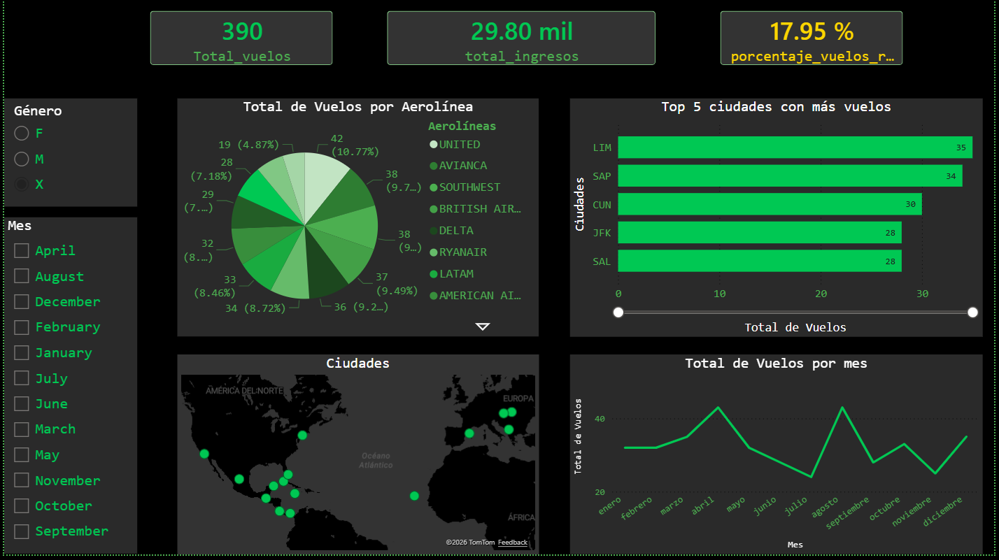
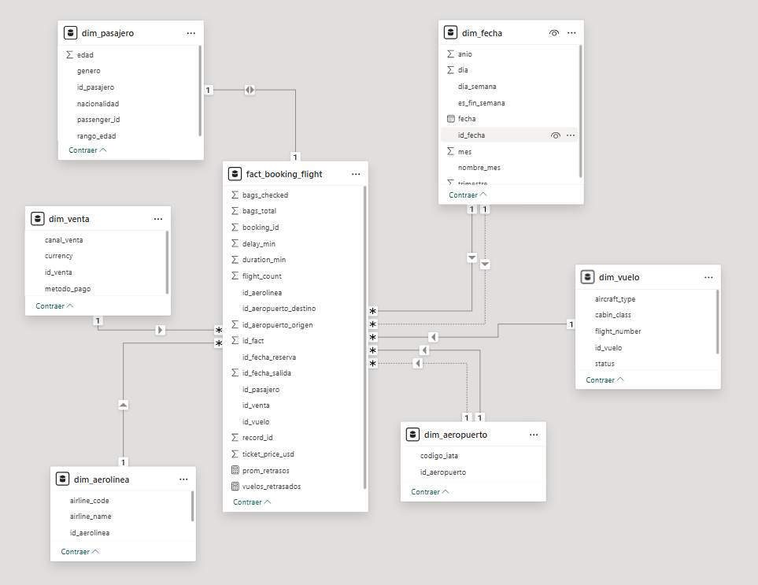

# Introducción

En la actualidad, el análisis de datos se ha convertido en una herramienta fundamental para la toma de decisiones en las organizaciones. En este contexto, el uso de herramientas de Business Intelligence permite transformar grandes volúmenes de datos en información clara, visual y útil.

En la presente práctica se desarrolló un dashboard interactivo utilizando Power BI, basado en un modelo de datos previamente construido en SQL Server. A partir de información relacionada con vuelos, pasajeros, aerolíneas y ventas, se diseñaron visualizaciones que permiten identificar patrones, tendencias y métricas clave del negocio.

El objetivo principal fue integrar, modelar y visualizar los datos de manera eficiente, facilitando el análisis mediante indicadores y gráficos interactivos que apoyen la interpretación de la información.

# Objetivos

- ## Objetivo general
    Desarrollar un dashboard interactivo en Power BI que permita analizar datos de vuelos mediante un modelo dimensional, facilitando la visualización de métricas clave y la toma de decisiones.

- ## Objetivos Específicos
    - Conectar Power BI a la base de datos generada en la
Práctica 1, diseñar un modelo tabular con relaciones,
jerarquías y medidas DAX, y construir un dashboard
interactivo con KPIs estratégicos.

    - Se considerará cumplido al generar un dashboard con al
menos tres visualizaciones, tres medidas DAX y un KPI con
semáforo o indicador de desempeño.

    - El objetivo se logra utilizando Power BI Desktop y la base
de datos relacional creada previamente, aplicando los
conocimientos adquiridos de modelado y análisis.

    - Contribuye al desarrollo de competencias en inteligencia
empresarial, análisis visual y comunicación efectiva de
resultados.


# Modelo de datos

Se utilizó un esquema estrella (Star Schema), donde:

- La tabla de hechos es:  
  `fact_booking_flight`

- Las dimensiones son:
  - `dim_pasajero`
  - `dim_aerolinea`
  - `dim_aeropuerto` (origen y destino)
  - `dim_fecha` (reserva y salida)
  - `dim_vuelo`
  - `dim_venta`


# Medidas Dax utilizadas

1. Cuenta el número total de registros en la tabla de hechos, representando la cantidad total de vuelos registrados en el sistema.

```DAX
Total Vuelos = COUNTROWS(fact_booking_flight)
```

2. Calcula la suma total de los ingresos generados por la venta de boletos, utilizando el valor en dólares (`ticket_price_usd`).

```DAX
Ingresos Totales = SUM(fact_booking_flight[ticket_price_usd])
```

3. Obtiene el promedio de minutos de retraso de los vuelos, permitiendo analizar el nivel general de puntualidad.

```DAX
Retraso Promedio = AVERAGE(fact_booking_flight[delay_min])
```

4. Cuenta la cantidad de vuelos que presentan retrasos, es decir, aquellos cuya duración de retraso es mayor a cero.

```DAX
Vuelos Retrasados = 
CALCULATE(
    COUNTROWS(fact_booking_flight),
    fact_booking_flight[delay_min] > 0
)
```

5. Calcula el porcentaje de vuelos retrasados respecto al total de vuelos. Este indicador es clave para evaluar el desempeño operativo.

```DAX
Porcentaje Retrasados = 
DIVIDE([Vuelos Retrasados], [Total Vuelos], 0)
```

# Visualizaciones

El dashboard incluye:

- KPIs

    - Total de vuelos

    - Ingresos totales

    - Porcentaje de vuelos retrasados

- Gráficos

    - Gráfico de pastel: vuelos por aerolínea

    - Gráfico de barras: top destinos

    - Gráfico de líneas: vuelos por mes

    - Mapa: distribución geográfica de vuelos

- Segmentadores

    - Género

    - Mes

## Funcionalidades del dashboard

El dashboard permite:

- Filtrar información por género y mes

- Analizar tendencias temporales de vuelos

- Identificar aerolíneas con mayor actividad

- Detectar destinos más frecuentes

- Evaluar el porcentaje de retrasos

# Dashboard



# Modelo tabular



# Conclusiones

1. Se logró desarrollar un dashboard interactivo que integra información de diferentes fuentes, permitiendo visualizar de manera clara los principales indicadores relacionados con los vuelos.

2. La implementación de un modelo estrella facilitó la organización de los datos y permitió realizar consultas eficientes, mejorando el rendimiento y la claridad del análisis.

3. El uso de medidas DAX permitió generar indicadores clave como el porcentaje de vuelos retrasados, aportando valor al análisis de la información.

4. Las visualizaciones diseñadas, junto con los filtros interactivos, permiten explorar los datos de manera dinámica, identificando tendencias y comportamientos relevantes.

5. El diseño del dashboard, basado en una paleta de colores coherente y un fondo oscuro, contribuye a una mejor experiencia visual y profesional.

6. En conjunto, la práctica demuestra la importancia de integrar procesos de modelado de datos y herramientas de visualización para apoyar la toma de decisiones basada en datos.
