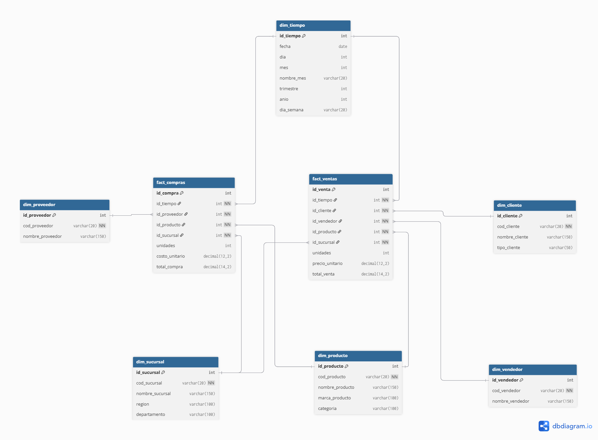

# Introducción

El presente proyecto tiene como objetivo el diseño e implementación de un sistema de análisis de datos basado en un Data Warehouse, utilizando herramientas de Microsoft como:

- SQL Server (Base de datos)
- SSIS (ETL)
- SSAS (Cubo OLAP)

El sistema permite transformar datos operacionales en información analítica útil para la toma de decisiones, mediante la creación de un modelo dimensional tipo estrella y un cubo multidimensional.

# Objetivos

- ## Objetivo General
    Desarrollar una solución de inteligencia de negocios que permita analizar información de ventas y compras mediante un cubo OLAP.

- ## Objetivos Específicos
    - Diseñar un modelo dimensional que se adecue a los archivos propuestos para el proyecto.
    - Implementar procesos ETL utilizando la herramienta SSIS.
    - Construir un cubo OLAP utilizando la herramienta SSAS.
    - Analizar datos mediante medidas e indicadores.

## Arquitectura del proyecto

Fuente de datos (CSVs) -> SSIS (ETL) -> Data Warehouse -> SSAS (Cubo OLAP)

Componentes:

- Fuente de datos: archivos o base inicial
- SSIS: extracción, transformación y carga
- Data Warehouse: modelo estrella en SQL Server
- SSAS: análisis multidimensional

# Modelo Dimensional

Se implementó un modelo tipo Constelación, el cual está compuesto por las siguientes tablas:

**Tablas de dimensión:**

- dim_cliente
- dim_producto
- dim_proveedor
- dim_sucursal
- dim_vendedor
- dim_tiempo

**Tablas de hechos:**

- fact_ventas
- fact_compras

# Proceso ETL utiliando la herramienta SSIS

El proceso ETL se desarrolló utilizando la herramienta SQL Server Integration Services (SSIS)

## Extracción

Se extrajeron los datos desde la fuente orginal, que en este caso fueron los 2 csv (ventas.csv y compras.csv).

## Transformación

Se aplicaron las siguientes transformaciones 
- Limpieza de datos
- Conversión de tipos
- Eliminación de duplicadoes
- Normalización de datos
- Generación de claves.

## Carga

Los datos fueron cargados en el Data Warehouse en este orden (debido a dependencias entre tablas).

1. Tablas de dimensiones:
    - dim_tiempo
    - dim_cliente
    - dim_vendedor
    - dim_proveedor
    - dim_producto
    - dim_sucursal

2. Tablas de hechos:
    - fact_ventas
    - fact_compras

## Problemas y errores corregidos en SSIS

### 1. Inconsistencia en los tipos de datos

Los datos provenientes de la fuente presentaban diferencias en los tipos de datos esperados en el Data Warehouse, lo que generaba errores al momento de cargar la información.

Solución:
Se aplicaron transformaciones en SSIS como:

Data Conversion
Derived Column

Para asegurar compatibilidad con:

- INT
- VARCHAR
- DATE
- DECIMAL

### 2. Datos nulos o incompletos

Algunos registros contenían valores nulos en campos clave, lo cual afectaba la integridad de las dimensiones y hechos.

Solución:

- Se implementaron reglas de limpieza
- Se reemplazaron valores nulos
- Se filtraron registros inválidos

### 3. Duplicados en los registros

Se detectaron registros duplicados en las dimensiones, lo que podía provocar inconsistencias en el modelo.

Solución:

- Uso de transformaciones para eliminar duplicados.
- validación previa antes de la carga.

### 4. Conversión de formatos de fecha

Los formatos de fecha no eran consistentes.

Solución:

Se normalizó el formato utilizando transformaciones en SSIS para cumplir con el estándar del DW.

### 5. Valores negativos en Costo unitario y Unidades

Algunos datos de costo unitario y unidades estaban negativos, por lo que eran datos incorrectos e ilógicos.

Solución:

Se utiliaron transformaciones para obtener el valor absoluto de esos dos tipos de datos.

### 6. Generación de claves

Las dimensiones requerían claves únicas,

Solución:

Se implementó generación de claves en las tablas de Data Warehouse.

# Cubo OLAP con SSAS

Se implementó un cubo multidimensional en SQL Server Analysis Services (SSAS)

## Medidas (Measures)

1. **Fact Ventas:**
    - Total Venta
    - Precio Unitario
    - Unidades Vendidas

2. **Fact Compras:**
    - Total Compras
    - Unidades compradas

## Jerarquías definidas en SSAS

En el cubo OLAP desarrollado en SQL Server Analysis Services (SSAS), se definieron jerarquías que permiten navegar la información de forma estructurada.

### Dimensión Tiempo

Anio -> Trimestre -> Mes -> Fecha

Esta jerarquía permite analizar los datos de forma temporal, desde un nivel general (año) hasta el nivel más detallado (fecha), facilitando análisis como:

- Ventas por año
- Ventas por trimestre
- Tendencias mensuales

Configuración técnica:

Año → clave: anio

Trimestre → clave compuesta: anio + trimestre

Mes → clave compuesta: anio + mes

Fecha → clave: fecha

### Dimensión Producto

Categoria -> Producto

Permite analizar el comportamiento de ventas y compras por tipo de producto.

Ejemplos:

- Ventas por categoría
- Productos más vendidos

### Dimensión Cliente

Tipo Cliente  -> Clinete

Permite segmentar clientes y analizar su comportamiento de compra.

### Dimensión Sucursal

Region -> Sucursal

Permite evaluar el rendimiento por ubicación geográfica.

### Dimensión Proveedor

Proveedor

No requiere de jerarquía alguna, pero permite un análisis directo.

### Dimensión Vendedor

Vendedor

No requiere de jerarquía alguna, pero permite un análisis directo.

# Conclusiones

- Se logró implementar exitosamente un sistema completo de BI.
- SSIS permitió automatizar la carga de datos.
- SSAS facilitó el análisis multidimensional.
- El modelo constelación optimizó consultas analíticas.